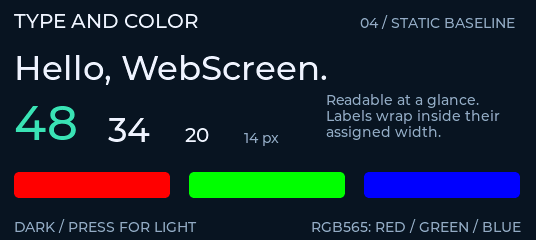

# LVGL Typography

**Requires WebScreen firmware 4.0 (LVGL 9.5 compatible).**

Font sizes, wrapped text, RGB color bars, and switchable dark and light themes. Designed for the 536 × 240 display; no Wi-Fi, external assets, or custom configuration needed.



## Install

In [WebScreen Admin](https://admin.webscreen.cc), open **Apps**, search for **LVGL Typography**, and install it. Admin saves `lvgl95_typography.js` and makes it the startup app.

To try it without changing your startup app, upload `script.js` as `lvgl95_typography.js` with the Serial IDE, then run:

```text
/load lvgl95_typography.js
```

Wait for `DEMO READY:` before sending another command. Keep your existing `webscreen.json`; `app.json` is the app manifest and is not a replacement for your device settings.

## Controls and checks

- **Short press:** Dark / light.
- **Long press:** power off, as usual.
- In the serial console, `/eval demo_button(1);` also advances the mode.

Check text wrapping, contrast, and the red, green, blue order of the color bars. Use `/errors` and `/stats` to inspect runtime health; `/screenshot` captures the display. This is a static demo with no timer.
